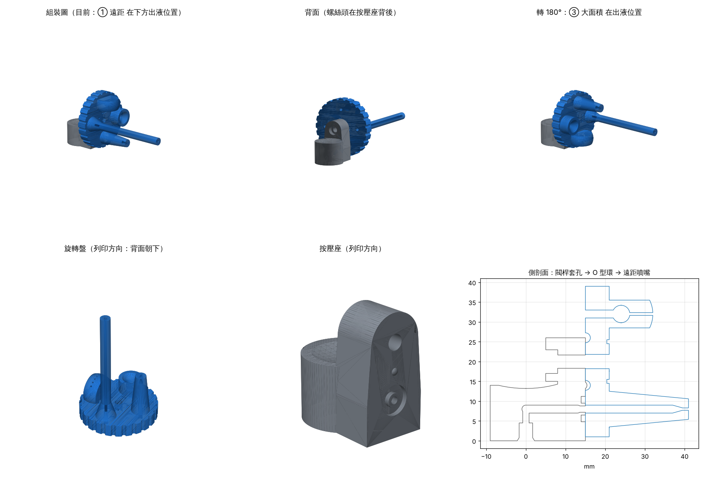

# RoachHunter 四合一旋轉殺蟑噴頭

替換**殺蟲劑噴霧罐**原廠按壓頭的 3D 列印噴頭。4 種噴嘴裝在同一個**旋轉盤**上，轉動轉盤就能切換噴嘴，用法跟園藝水管的多段噴頭一樣。



## 4 種噴嘴

轉盤正面靠近中心刻有 1~4 個圓點，標示每個噴嘴的編號。**轉到轉軸正下方（對準出液口）的那一個就是使用中的噴嘴**，轉到定位時會「喀」一聲。

| 編號 | 噴嘴 | 用途 | 噴出方式 |
|---|---|---|---|
| ● | **遠距** | 牆角、天花板上的蟑螂 | 收斂式 0.6 mm 噴孔，柱狀直線射出 |
| ●● | **近距** | 近身直接噴 | 1.2 mm 喉部加擴散錐，圓錐霧狀 |
| ●●● | **大面積** | 地板、櫃底整片噴 | 分配腔加 7 孔扇形，水平展開 ±45° |
| ●●●● | **縫隙** | 牆縫、冰箱或流理台後方 | 外徑 4.8 mm、長 55 mm 的細管 |

## 要印的檔案

| 檔案 | 說明 | 尺寸 (mm) |
|---|---|---|
| `stl/stem_fit_gauge.stl` | 量測規，**先印這個** | 67 × 14 × 6 |
| `stl/turret_base/turret_base_bore_X.Xmm.stl` | 按壓座，依量測結果選 1 個 | 24 × 18 × 26 |
| `stl/turret_disc.stl` | 旋轉盤（4 噴嘴） | Ø38 × 61 |

### 第 1 步：量閥桿尺寸

拔掉噴霧罐原本的按壓頭。量測規有 7 個孔，從左到右是 3.0、3.2、3.4、3.6、3.8、4.0、4.2 mm，孔旁的刻線數 1~7 代表第幾孔。把閥桿插進每個孔試，找出**要稍微用力才壓得進去、拔起來不會鬆**的那個，再印對應尺寸的按壓座。

### 第 2 步：準備五金（五金行都買得到）

| 零件 | 數量 |
|---|---|
| M3 × 20 mm 螺絲 | 1 |
| M3 尼龍防鬆螺帽 | 1 |
| M3 墊片 | 1 |
| O 型環，內徑 3 mm × 線徑 1.5 mm（耐油 NBR） | 1 |

### 第 3 步：列印

| 項目 | 建議值 |
|---|---|
| 材料 | **PETG**（耐殺蟲劑溶劑）。避免 PLA 和 ABS，可能被溶劑侵蝕 |
| 擺放 | 直接照檔案方向印，**不需要支撐**。旋轉盤背面朝下，噴嘴朝上 |
| 層高 | 0.12 ~ 0.16 mm |
| 填充 | 100% |
| 牆數 | 4 以上 |
| 旋轉盤 | 開 brim。縫隙細管高 55 mm，建議降速或開「最短層時間」避免晃動 |

旋轉盤背面直接貼平台印，表面會最平滑，密封效果最好，**請勿翻面**。

### 第 4 步：通孔與組裝

1. 通孔：FDM 印的小孔容易堵。遠距噴孔用 0.6 mm 通針、扇形 7 孔用 0.7 mm、縫隙管出口用 1.2 mm，各通一次。
2. 把 O 型環壓進按壓座正面**下方**的圓形溝槽。
3. M3 螺絲**從按壓座背面**穿過轉軸孔（螺絲頭藏進背面沉孔）。
4. 把旋轉盤套上螺絲，背面貼著按壓座。
5. 套上墊片，鎖上尼龍防鬆螺帽。**鎖到轉盤要稍微用力才轉得動，而且轉到定位時有明顯的「喀」聲**。太鬆會漏液，太緊轉不動。
6. 把整組壓到噴霧罐的閥桿上。

## 使用前一定要試

- 每個噴嘴都先**對著室外或垃圾桶試噴**，確認轉盤與按壓座之間沒有漏液。如果有漏，把螺帽再鎖緊一點，或檢查 O 型環有沒有裝正。
- 這個設計我只做過幾何檢查（4 個位置都不會互相干涉、流道都對得準），**還沒有實際列印試噴**。實際的密封效果、射程和霧化效果，要你印出來試了才知道。有問題把狀況告訴我，我再調整。

## 安全提醒

- 遠距噴嘴射程較遠，不要對人、寵物、食物噴。
- 殺蟲劑噴霧罐內含易燃推進劑，不要在爐火或熱源附近使用。
- 用完把噴頭拔下，用清水沖過流道，避免殘液乾掉堵孔。

## 自己調整尺寸

設計是參數化的，可以用 Python 重新產生：

```bash
pip install manifold3d trimesh
```

```bash
python3 generate_nozzles.py --bore 3.5 --orifice 0.8 --out my_stl
```

- `--bore`：只產生這個套孔直徑（mm）的按壓座
- `--orifice`：遠距噴孔直徑（mm），0.5 更細更遠，0.8~1.0 水柱更粗

其他尺寸（噴嘴位置半徑、轉盤大小、扇形角度、縫隙管長度、O 型環規格等）都在 `generate_nozzles.py` 開頭的參數區。
